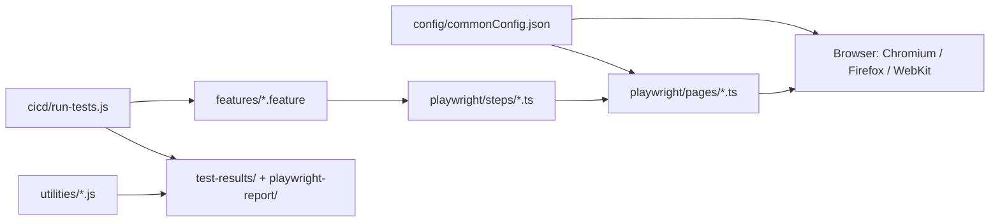

# Project Overview

This repository is a TypeScript-based UI test automation framework that combines
Playwright, Cucumber, and the Page Object Model to validate web interfaces through
browser automation and Gherkin-driven scenarios. It is designed for reproducible
regression testing, browser-matrix execution, and AI-assisted discovery, impact
analysis, failure diagnosis, and exploratory validation across Chromium, Firefox,
and WebKit.

## Repository Structure

- `features/` - Gherkin feature files that define user journeys and acceptance
  checks.
- `playwright/` - Browser automation runtime, page object classes, steps, and
  support code.
- `playwright/config/` - Playwright test configuration and browser selection.
- `playwright/pages/` - Page Object Model classes for page-specific UI actions.
- `playwright/steps/` - Cucumber step definitions that map Gherkin to code.
- `playwright/support/` - Hooks, shared page manager, and runtime wiring.
- `config/` - Shared JSON configuration for browser, timing, and evidence settings.
- `utilities/` - Local automation utilities for discovery, coverage, impact, and
  diagnosis workflows.
- `cicd/` - CI and quality-gate scripts, integration checks, and workflow support.
- `documentation/` - Project docs for Playwright, Cucumber, testing, and AI agents.
- `specs/` - Small smoke and regression specs alongside the main framework.
- `test-results/` - Generated reports, screenshots, videos, and evidence artifacts.
- `playwright-report/` - Static HTML report output produced by Playwright.
- `ai.agents/` - Local agent definitions and automation scaffolding.
- `.github/` - GitHub automation, workflows, and repo-level agent metadata.
- `node_modules/` - Installed dependencies; generated by package managers.

## Build & Development Commands

```bash
# Install dependencies
npm install

# Install browser binaries for local runs
npx playwright install chromium
npx playwright install

# Run the default Cucumber suite
npm test

# Run headed or browser-specific suites
npm run test:headed
npm run test:ui
npm run test:parallel
npm run test:browsers
npm run test:chromium
npm run test:firefox
npm run test:webkit
npm run test:ui:parallel
npm run test:ui:all

# Type-check the TypeScript project
npm run typecheck

# Debug and evidence-generation workflows
npm run test:discover -- --url https://testautomationpractice.blogspot.com/ --max-pages 5
npm run test:impact -- --base main --head HEAD
npm run test:diagnose -- --input test-results --browser chromium
npm run test:heal-locators -- --url https://testautomationpractice.blogspot.com/ --browser chromium --selector "#name" --description "Name input"
npm run test:coverage-gaps -- --url https://testautomationpractice.blogspot.com/ --browser chromium --max-pages 10
npm run test:exploratory -- --url https://testautomationpractice.blogspot.com/ --browser chromium --max-pages 10 --max-actions 20

# CI-style validation
npm run test:ci:quality-gates
```

> TODO: no repo-local lint script is defined in `package.json`; prefer `npm run typecheck`
> and the CI quality gates in `cicd/quality-gates.md`.

> TODO: no deploy script is defined in this repository; it is a test automation project,
> not an application deployment pipeline.

## Code Style & Conventions

- Use TypeScript for framework logic and keep implementations typed; `tsconfig.json`
  sets `strict: true` and `moduleResolution: Node16`.
- Prefer PascalCase for Page Object classes and camelCase for methods and local
  variables.
- Keep browser actions in `playwright/pages/`, scenario wiring in `playwright/steps/`,
  and shared configuration in `config/` and `utilities/`.
- Keep feature files in Gherkin style (`Given`, `When`, `Then`) and maintain a small,
  readable scenario body.
- Use environment variables for local overrides; `config/commonConfig.json` is the
  default source of browser and evidence settings.
- No dedicated lint config is checked in; rely on TypeScript checking and repo review
  discipline instead of an auto-formatter or ESLint preset.
- Commit messages are not centrally templated in-repo; if you add one later,
  prefer Conventional Commits and a scoped summary.

## Architecture Notes



The core execution flow starts with Gherkin feature files in `features/`. Cucumber
loads the step definitions in `playwright/steps/` and invokes the page-object methods
in `playwright/pages/` to perform browser actions. Shared browser state, viewport,
headless mode, screenshots, and video settings come from `config/commonConfig.json`.

The runtime applies environment overrides such as `BROWSER`, `HEADLESS`, `BASE_URL`,
`BROWSERS`, and `WORKERS` before launching Playwright. Evidence artifacts are stored in
`test-results/` and the HTML report is generated in `playwright-report/`. The utilities
folder adds local test-generation, diagnosis, impact, and exploration functions that
review results before any source changes are accepted.

## Testing Strategy

This project combines BDD, Playwright browser tests, and lightweight CI quality gates.

- BDD suite: `npm test` runs the Cucumber feature suite.
- Playwright suite: `npm run test:ui` executes browser tests from `playwright/tests/`.
- Parallel runs: `npm run test:parallel`, `npm run test:ui:parallel`, and the
  browser-matrix commands run the suite across multiple workers or browsers.
- Targeted runs: `npm run test:discover`, `npm run test:impact`,
  `npm run test:diagnose`, `npm run test:coverage-gaps`, and
  `npm run test:exploratory` build review artifacts or analyze existing evidence.

```bash
# Local validation
npm test
npm run test:ui
npm run test:ui:all
npm run test:parallel
npm run test:ci:unit
npm run test:ci:integration
npm run test:ci:quality-gates
```

CI is driven by `cicd/run-tests.js` and `cicd/tests/*.js`. The quality gate checks
include unit checks with Node's built-in test runner and an integration check against
`BASE_URL` and expected title/text values. See `cicd/quality-gates.md` for the exact
workflow and environment variables.

## Security & Compliance

- Do not commit secrets, credentials, or private URLs; keep values in local shell
  environment variables or a local `.env` file that is excluded from git.
- The repo includes `.env.example` but it is not a full secret template; treat all
  runtime values as environment-scoped and review any additions before committing.
- Dependencies are managed by `package.json` and `package-lock.json`; no dedicated
  dependency scanner or SBOM workflow is checked in by default.
- The project license is ISC; review the root `LICENSE` before redistributing or
  reusing the code in commercial contexts.
- Use the repo's documented approval flow for AI-generated changes; do not allow
  auto-approval of destructive or sensitive browser actions.

> TODO: add an explicit dependency-scanning step such as `npm audit`, Dependabot, or a
> CI security gate if this project is hardened for production usage.

## Agent Guardrails

- Treat `utilities/` and `.github/` agent scripts as review-first automation, not
  direct mutation tools.
- Never edit generated artifacts under `test-results/` or `playwright-report/`
  unless the change is explicitly required to fix a broken report output.
- Self-healing locator and coverage-gap flows require human approval before any
  source change is applied.
- Exploratory testing blocks destructive actions such as checkout, payment, logout,
  removal, or account closure unless the run is explicitly authorized.
- Keep browser runs bounded with `--max-pages`, `--max-actions`, and worker limits;
  avoid broad automated sweeps without a clear purpose.
- Review all evidence before merging automation changes; prefer explicit human sign-off
  for scenario edits, locator replacements, and coverage additions.

## Extensibility Hooks

- Extend the browser matrix by changing `config/commonConfig.json` or using
  `BROWSERS`, `WORKERS`, `HEADLESS`, and `BASE_URL` environment variables.
- Add new scenarios under `features/` and map them to step definitions in
  `playwright/steps/`.
- Add page-specific interactions in `playwright/pages/` to keep page logic separate
  from the business flow.
- Add analysis or review flows in `utilities/` for new discovery or diagnosis tasks.
- The repo does not provide a formal plugin framework; feature toggles and custom logic
  are implemented through configuration files, environment variables, and utility scripts.

> TODO: no dedicated feature-flag system is present; if feature flags are added,
> define them in `config/` and document the override contract.

## Further Reading

- [README.md](README.md)
- [cicd/quality-gates.md](cicd/quality-gates.md)
- [cicd/github-actions.md](cicd/github-actions.md)
- [documentation/browser-installation-and-parallel-execution.md](documentation/browser-installation-and-parallel-execution.md)
- [documentation/playwright.md](documentation/playwright.md)
- [documentation/cucumber-bdd.md](documentation/cucumber-bdd.md)
- [documentation/coverage-gap-analysis.md](documentation/coverage-gap-analysis.md)
- [documentation/exploratory-testing.md](documentation/exploratory-testing.md)
- [LICENSE](LICENSE)
